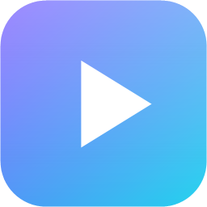

<p align="center"></p>

# BWOS 2.0

A controller-first Windows entertainment shell for a TV or projector. The rebuilt app is now the default `BWOS.exe` and the default source build.

Home, For You, Games, Apps, Devices and Settings use a restrained glass interface with spatial focus. Provider playback stays in one persistent fullscreen Edge window, with explicitly owned service tabs and separate temporary discovery tabs. Home does not depend on a provider page responding. A bounded action broker joins controller, keyboard, phone, voice and remote-viewer actions.

- Games from Steam, Epic, GOG and Ubisoft, plus manual titles/emulators; launch, resume and quit.
- Apps opens the original service interfaces. YouTube cards, saved videos, search and Continue Watching use the same TV session. Netflix and Prime retain native provider playback.
- For You uses retained collected shelves, source status, deduplication, progressive artwork, paging and Unicode search with an on-screen keyboard.
- One compact Now Playing cloud and a transient desktop companion, with available provider controls.
- Free local English/Hindi voice, NVIDIA acceleration with CPU fallback, microphone selection and Windows echo/noise handling. Default wake phrase: **Hey console**.
- Controller and Bluetooth/audio information, driver-supported connection controls, persistent revocable phone pairing, DIAL/AirPlay adapters, and selected-screen WebRTC streaming with requested system audio and remote controls.

## Install or update

Download [BWOS 2.0.0](https://github.com/timedilatesme/bwos/releases/tag/v2.0.0), unzip it and run `BWOS.exe`.

For an existing portable installation, close BWOS and replace only `BWOS.exe`, `ui` and `extensions`. Keep `data` in place: it contains preferences, history, browser profiles/sign-ins, phone records and voice assets. The primary app retains the original ports, 47913 for its shell and 47914 for the LAN remote. Existing startup entries continue to target `BWOS.exe`.

Optional per-user installation:

```powershell
powershell -ExecutionPolicy Bypass -File .\install.ps1 -Autostart
```

The installer keeps `data` and backs up the previous executable/UI/extension payload. In the source checkout, the installer is `tools\install.ps1`.

## Build and test

The Windows host builds with the .NET Framework compiler included with Windows; no SDK is needed.

```powershell
.\build.ps1 -Test             # rebuilt app -> dist\BWOS\BWOS.exe
.\build.ps1 -Zip              # portable release, without personal data
.\build.ps1 -Run              # build and launch; close the running host first
.\build.ps1 -Legacy           # preserved 1.8.1 -> dist\BWOS-Legacy\BWOS.exe
.\replacement\build.ps1 -Test # optional isolated preview -> dist\BWOS-Next
node --test replacement/tests/*.test.mjs
.\tools\test-features.ps1
node --test tests/*.test.mjs
```

The GitHub tag workflow validates the primary version, runs both regression suites and primary host assertions, builds the ZIP, checks that it contains no runtime data, writes a SHA-256 checksum and publishes the release.

## Verification and limits

See [release notes](docs/RELEASE_2.0.0.md), [architecture](replacement/README.md) and [verification](replacement/VERIFICATION.md). The automated checks cover session ownership, concurrent discovery/open/Home/cleanup, frozen adapters, repeated reopen cycles, duplicate commands, cancellation, Unicode text, source rows and screen-session revocation. Headless UI checks use clearly generated fixtures.

The direct YouTube TV browser route is a compatibility integration. Provider DRM, background playback, captions and progression depend on the service. Signed-in fresh feeds are best-effort rendered-page collections, not invented or guaranteed personalized APIs. Actual audio/physical Home, real microphone behavior with music interference, and Mac/Safari reception remain unverified after the live Windows inspection guard stopped the previous check. Wake waiting still uses Whisper transcription; a separate fast wake detector is not implemented. Screen capture needs a user selection and an actual returned audio track; protected video may be black.

Existing voice/device details and optional UxPlay/AirPlay setup are in [VOICE_AND_DEVICES.md](docs/VOICE_AND_DEVICES.md). The old 1.8.1 interface documentation is retained as [legacy documentation](docs/LEGACY_1.8.1_README.md); its UI-specific instructions are historical.

Configuration remains `data\config.json`. Add custom games using the Games screen or its `customGames` entries. Controller mappings in the new shell are stored in the browser profile. The old source remains available for rollback; replacing the app payload does not delete the shared data folder.
