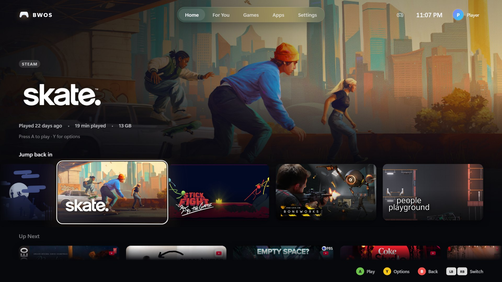
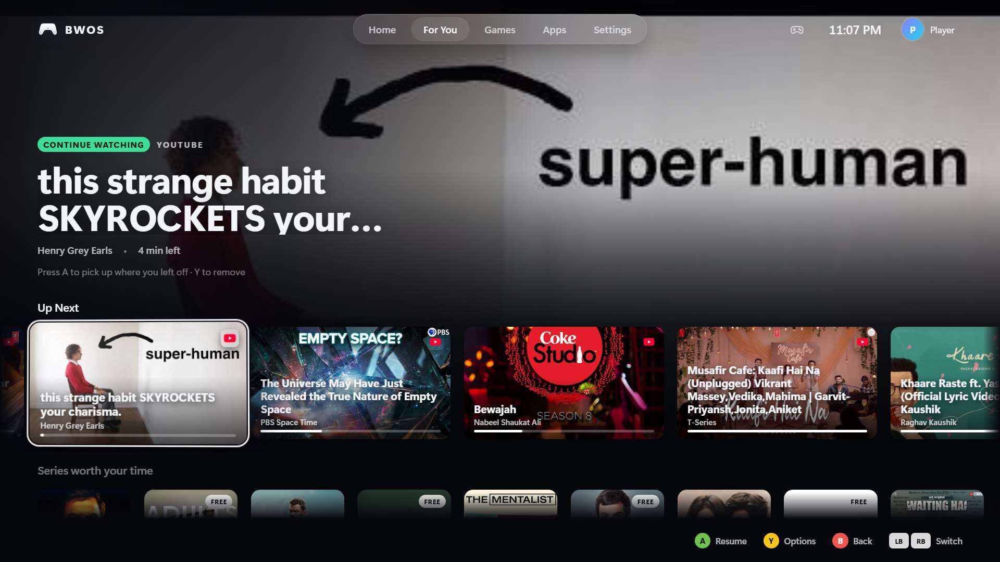
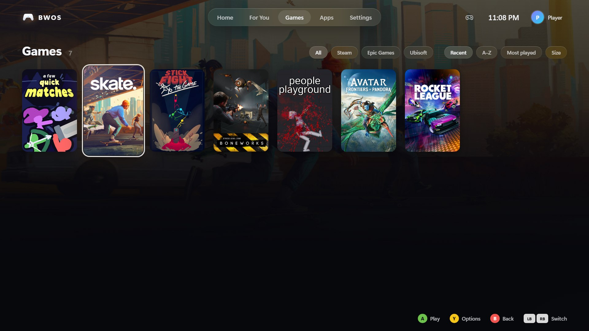
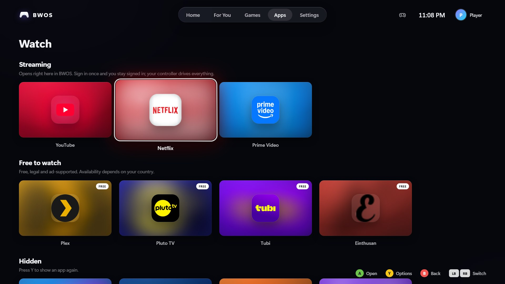
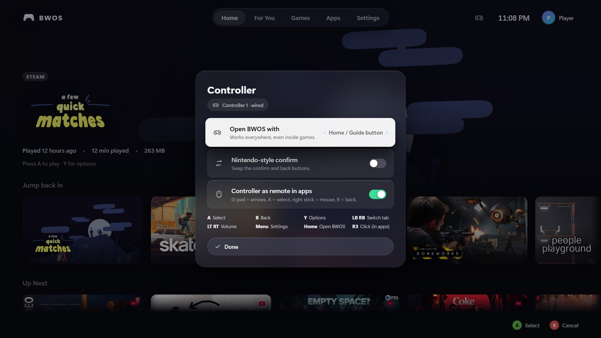

<p align="center"></p>

<h1 align="center">BWOS</h1>

<p align="center"><b>A console-style, controller-first home screen for a Windows PC on your TV or projector.</b></p>

Press the **home button on your controller** from anywhere, even in the middle of a game, and BWOS slides in:
your games from **Steam, Epic Games, GOG and Ubisoft Connect**; **Netflix, Prime Video, YouTube** and free
services running *inside* BWOS; a **For You** tab that learns what you watch; and power controls. Everything is
driven with the controller, and the frosted-glass design is inspired by tvOS.

<p align="center"></p>

| | |
|---|---|
|  |  |
| **For You:** your services' catalogue, Up Next across apps | **Games:** Steam, Epic, GOG and Ubisoft in one place |
|  |  |
| **Apps:** Netflix, Prime Video, YouTube TV and free services, inside BWOS | **Controller:** pads, battery, home button and button map |

## Features

**Games**
- **Home button → BWOS, anywhere.** A small tray service watches your controllers in the background:
  - Xbox and XInput pads through the Guide-button API.
  - PlayStation and Switch Pro through raw HID.
  - **Ctrl + Alt + Home** as a keyboard fallback.
  - Pressing Home again jumps back into the running game.
- **One library.** Steam (every library folder, playtime, last played, local artwork), Epic Games, GOG and
  Ubisoft Connect are found automatically. Titles from other stores get artwork from Steam's public store data,
  and anything else (emulators, Xbox app games) can be added in `config.json`.
- **Now playing.** BWOS detects the running game, offers *Resume* and *Quit*, gets out of the way when a game
  starts, and comes back when a game it launched closes.

**Watching**
- **Apps inside BWOS.** Netflix, Prime Video, YouTube, Einthusan, Tubi, Pluto TV and Plex open *inside* the BWOS
  window, in one persistent browser profile, so you sign in to each service once.
- **A controller layer for every site.** The bundled `bwos-tv` extension adds:
  - A TV focus ring you move with the D-pad, including onto posters built as plain clickable `<div>`s.
  - A = select, B = back.
  - Automatic full screen for in-page players.
  - Blocking of pop-up and new-tab ads.
- **One press to play.** Picking a title in For You opens it on the right service and presses its Play button.
- **For You.** Series and films from *your* services (catalogue data from JustWatch, plus Einthusan's own
  lists). It starts with a few clean rows and grows as you watch:
  - **Up Next** follows each show across services, with progress bars, and resumes where you stopped.
  - **"Because you watched …"** rows appear on their own.
  - Reality TV is filtered out.
- **YouTube TV.** YouTube opens in its 10-foot TV interface with ad schedules and promotions stripped out.
- **Your phone as a remote.** Scan the QR code once (**Settings → Phone remote**, or **Menu** in any app) and
  your phone becomes an Apple TV-style remote: swipe on the touch surface to move, tap to select, with Back,
  Home, Play/Pause and volume, plus a keyboard tab for sign-ins and searches. The phone stays paired; add the
  page to its home screen for one-tap access. Works with any phone or tablet on your Wi-Fi.
- **Cast from your phone.** In the YouTube app on Android or iPhone, tap Cast and pick **BWOS (your PC's name)**,
  just like a smart TV. BWOS answers YouTube's TV discovery (DIAL) on your home network, comes to the front and
  opens YouTube TV linked to your phone, which then works as the remote.
- **AirPlay from iPhone, iPad or Mac** (optional add-on). Choose **Screen Mirroring → BWOS (your PC's name)** and your
  screen appears full-screen on the TV; press Home on the controller to go back to BWOS. It uses
  [UxPlay](https://github.com/FDH2/UxPlay) (GPL-3.0), which a setup script builds for you (see [AirPlay](#airplay)).

**Feel**
- **Any controller.** Xbox, PlayStation, Switch Pro and generic pads, with matching button prompts (A/B, ✕/○)
  and a Nintendo-style confirm swap. Keyboard and mouse also work.
- **Polished 10-foot UI.** Frosted glass, a focus parallax with moving glare, artwork-tinted colour, and shelves
  that remember your place. A soft, **generative ambient soundtrack** never repeats and fades out for games
  and videos. There's also an idle screensaver.
- **A start-up worth watching.** Light traces the outline of a controller, it fills in, its home button lights
  up, and BWOS opens around it.
- **Yours.** Pick the name shown in the top corner (it defaults to your Steam name), and open controller settings
  straight from the controller icon next to it.
- **Triggers = volume** whenever BWOS is on screen.
- **Projector-friendly idle.** After a while with nothing happening, BWOS fades to black but keeps the video
  signal, so a projector stays on instead of dropping to standby. Any button brings it back instantly, and the
  home button also turns displays back on if Windows switched them off. Optionally, after a longer time, BWOS
  hands over to Windows' power settings so the projector can go to standby.
- **Open on wake.** When the PC wakes from sleep (or you sign in right after), BWOS comes straight up.

**No dependencies to build.** BWOS compiles with the C# compiler that ships inside Windows (.NET Framework 4.8),
so you don't need an SDK, Node or Visual Studio. The interface runs in Microsoft Edge's app mode, which every
Windows 10/11 PC has.

## Install

1. Download `BWOS-<version>.zip` from Releases (or build it, below) and unzip it anywhere.
2. Run `BWOS.exe`. That's it: BWOS is portable.

To install it properly, with a Start-menu entry and optionally start-with-Windows:

```powershell
powershell -ExecutionPolicy Bypass -File .\tools\install.ps1 -Autostart
```

This copies BWOS to `%LOCALAPPDATA%\Programs\BWOS`. Run `install.ps1 -Uninstall` to remove it.

### AirPlay

AirPlay mirroring is an optional add-on because it relies on UxPlay, a separate open-source program (GPL-3.0).
One command builds it into BWOS's `data\tools` folder with a private MSYS2 environment. Nothing is installed
system-wide and no administrator rights are needed (about 650 MB to download, 2 GB on disk):

```powershell
powershell -ExecutionPolicy Bypass -File .\tools\setup-airplay.ps1
```

Restart BWOS afterwards; it starts UxPlay in the background by itself (**Settings → AirPlay** turns it off).
The first time, Windows asks to let `uxplay.exe` through the firewall: allow it on the network type your Wi-Fi
uses. If that prompt was dismissed, Windows blocks it; fix it from an administrator PowerShell with
`Get-NetFirewallRule -DisplayName uxplay | Set-NetFirewallRule -Action Allow`.

Netflix, Prime Video and other DRM-protected apps show a black screen when mirrored (they block mirroring);
open those in BWOS itself.

### One-time setup for the home button

Steam and the Xbox Game Bar also listen for the Guide button. Turn them off once:

1. **Steam → Settings → Controller →** turn off **Guide Button Focuses Steam**.
   If Big Picture still opens, also unbind Guide in Steam's *Desktop Layout*.
2. **Windows Settings → Gaming → Game Bar →** turn off **Open Game Bar using this button on a controller**.
3. **BWOS → Settings → Start BWOS with Windows**, so the home button always works.

If you'd rather not change Steam, set **Settings → Open BWOS with** to *View + Menu together* or *Hold View*.

## Controls

| On the BWOS screens | Xbox | PlayStation |
|---|---|---|
| Move | D-pad / left stick | D-pad / left stick |
| Select / play | A | ✕ |
| Back | B | ○ |
| Options (hide, quit game, remove from Up Next…) | Y | △ |
| Switch tab | LB / RB | L1 / R1 |
| Settings | Menu | Options |
| Volume down / up | LT / RT | L2 / R2 |
| Open BWOS / back to the game | Home | PS |

**Inside streaming apps**
- **Navigation:** D-pad moves the focus ring · A selects · B goes back · Home returns to BWOS.
- **Playback:** X play/pause · Y full screen · LT/RT volume.
- **Pointer:** the right stick moves a mouse pointer and R3 clicks.
- **Menu:** phone remote & keyboard (QR code).
- **Full-screen players** (Einthusan, Tubi, Plex…): ◀ ▶ skip 10 s, and B leaves full screen.

## Build from source

```powershell
powershell -ExecutionPolicy Bypass -File .\build.ps1          # → dist\BWOS\BWOS.exe
powershell -ExecutionPolicy Bypass -File .\build.ps1 -Run     # build and start
powershell -ExecutionPolicy Bypass -File .\build.ps1 -Zip     # also dist\BWOS-<version>.zip (no personal data)
```

`BWOS.exe --background --dev` starts without opening the UI and writes the UI's address to `data\bwos.log`, so you
can open it in any browser with developer tools.

## Configuration

Settings live in `data\config.json` next to `BWOS.exe` (or `%LOCALAPPDATA%\BWOS` if that folder is read-only).
Most are changed from the Settings screen; the file is safe to edit while BWOS is closed.

```jsonc
{
  "trigger": "guide",               // guide | back+start | hold-back
  "controllerBridge": true,         // controller → keyboard/mouse inside streaming apps
  "country": "IN",                  // For You region (blank = Windows region)
  "blankAfter": 10,                 // minutes idle before the screen fades to black (0 = never)
  "standbyAfter": 0,                // minutes idle before Windows may switch the display off (0 = never)
  "openOnWake": true,               // open BWOS when the PC wakes from sleep
  "castEnabled": true,              // show up in phones' YouTube cast menu
  "airplayEnabled": true,           // run the AirPlay add-on (UxPlay) when it's installed
  "userName": "",                   // name in the top corner (blank = your Steam name)
  "hidden": ["watch:twitch"],       // hidden games/apps (Y → Hide in the UI)
  "artOverrides": { "epic:Sugar": "252950" },   // borrow a Steam app's artwork for any game
  "customGames": [
    { "name": "RetroArch", "exe": "C:\\RetroArch\\retroarch.exe", "steamAppId": "1118310" },
    { "name": "My Xbox game", "uri": "shell:AppsFolder\\<PackageFamilyName>!App" }   // AppID: Get-StartApps
  ],
  "watch": [                        // the Apps; add, remove or reorder freely
    { "id": "prime", "name": "Prime Video", "section": "stream", "url": "https://www.primevideo.com",
      "jw": "prv", "country": "IN", "hosts": "primevideo.com", "color": "#1a98ff" }
    // section: stream | free | music · jw: JustWatch provider codes · country: per-app catalogue region
    // hosts: extra domains of the service · icon: optional icon URL · langs: Einthusan languages ("hindi,tamil")
  ]
}
```

Other files in `data\`: `watching.json` (Up Next history), `catalog.json` (recommendation cache), `art\` (app
icons), `profiles\shell\` (the BWOS browser profile with your sign-ins), `bwos.log`.

## How it works

```
 controller ─► BWOS.exe (tray, C#) ─────────────────► Edge --app, fullscreen ◄─ the BWOS UI (ui/)
               • home button: XInput Guide + HID       ▲   HTTP + SSE on 127.0.0.1 (token)
               • game libraries, launcher, now playing │
               • For You catalogue + watch tracker ────┘   same window navigates to Netflix, Prime, YouTube TV…
               • input bridge: pad → keys on sites          └─ bwos-tv extension: focus ring, full screen,
               • phone remote (LAN, paired phones)              ad-popup guard, progress, one-press play
```

| Path | What |
|---|---|
| `src/BWOS.Host/` | Tray host. `Gamepad.cs` / `HidWatcher.cs` (home button), `Library.cs` + `Vdf.cs` (game discovery), `GameManager.cs`, `ShellManager.cs` (window & focus), `InputBridge.cs`, `Catalog.cs` (For You), `Tracker.cs` (Up Next), `WatchArt.cs` (app icons), `PhoneRemote.cs` (phone remote & keyboard), `CastReceiver.cs` (YouTube casting), `AirPlayReceiver.cs` (runs UxPlay), `WebServer.cs` + `App.cs` (API) |
| `ui/` | The 10-foot interface: plain HTML/CSS/ES modules, no build step (`focus.js` spatial navigation, `input.js` controllers, `sound.js` UI sounds + ambient music) |
| `extensions/bwos-tv/` | Loaded into the BWOS window: `remote.js` (controller layer), `youtube.js` (TV UA + ad removal), `popups.js` (ad pop-up guard), `qr.js`, `background.js`, `rules.json` |
| `tools/` | `install.ps1`, `setup-airplay.ps1` (AirPlay add-on), `make-icon.ps1` (renders `tools/icon/icon.html`, the icon source, with headless Edge) |
| `docs/RESEARCH.md` | Research notes and design decisions |

## Privacy & security

- The UI talks to BWOS only on `127.0.0.1`, protected by a per-install token and a Host-header check.
- The phone remote listens on your home network only once you've used it. Pairing needs the one-time code in
  the QR on the TV (valid 15 minutes, one phone per code); a paired phone then keeps a random token, of which BWOS
  stores only a hash. Keys and text only reach the BWOS window while it's in front (Home and volume work
  anywhere, like the controller's). **Settings → Forget paired phones** revokes them all.
- Casting: BWOS answers YouTube's TV discovery (DIAL) on your home network while it runs. It only ever opens
  www.youtube.com/tv, and requests from web pages are refused. Turn it off in **Settings → Cast from your phone**.
- Watch history and sign-ins stay on your PC (`data\`). Nothing is uploaded. For recommendations, BWOS queries
  JustWatch's public catalogue with the titles you watch.

## Troubleshooting

- **The home button also opens Steam or Game Bar.** Do the one-time setup above.
- **The home button does nothing.** Check that the BWOS tray icon is there. For PlayStation/Switch pads that
  Steam holds exclusively, use *View + Menu* or Ctrl+Alt+Home.
- **BWOS isn't in my phone's cast menu.** Use the YouTube app (Netflix and other apps only cast to their own
  certified receivers), keep the phone on the same Wi-Fi, and allow BWOS through Windows Firewall. As a fallback, in
  YouTube TV open **Settings → Link with TV code**.
- **The phone can't open the keyboard page.** The phone must be on the same Wi-Fi, and Windows must allow BWOS
  on private networks (it asks the first time).
- **A site asks you to sign in again.** Sign in once *inside* BWOS; its browser profile is separate from your
  everyday Edge.
- **YouTube shows an ad anyway.** YouTube changes often, so update `extensions/bwos-tv/youtube.js`. Blocking ads
  is against YouTube's terms, and YouTube Premium is the supported ad-free option.
- **Logs:** `data\bwos.log`.

## Roadmap ideas

EA app and Xbox (Game Pass) auto-detection · owned-but-not-installed Steam games (Steam Web API key) · a local
media library (Plex/Jellyfin server) · multiple user profiles · MSIX packaging.

## License

[MIT](LICENSE) © 2026 Paras Sharma
