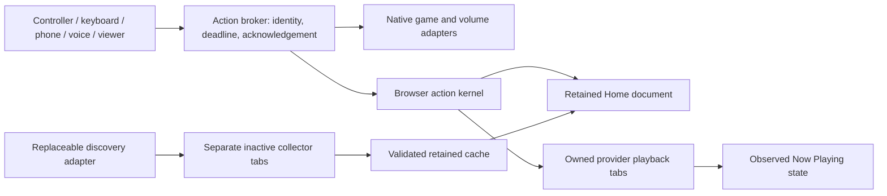

# BWOS Next — local preview

BWOS Next keeps the established Liquid Glass interface, controller input engine and shelf focus behavior, while replacing session ownership and action dispatch. It reuses the existing Windows/provider adapters behind those boundaries. The 2.0.0 release has been withdrawn; this candidate is for local testing only.

The default app is the restored 1.8.1 payload at `dist\BWOS\BWOS.exe`. Root `build.ps1` builds the established app. Run `replacement\build.ps1 -Test` to produce the separate preview at `dist\BWOS-Next\BWOS-Next.exe`. Test the preview with the real controller and provider accounts before any default promotion or new release.

## Design decision

Keep one permanent fullscreen Edge window, one retained Home document, and one explicitly owned tab for each provider. Use the real browser's native provider interface for sign-in and playback. Netflix lists Edge as a supported Windows browser; that is evidence for retaining Edge rather than choosing an unverified replacement decoder or promising equivalent DRM in a new webview. This remains an architectural inference, not account playback verification. [Netflix browser requirements](https://help.netflix.com/en/node/30081), [WebView2 profile separation](https://learn.microsoft.com/en-us/microsoft-edge/webview2/concepts/user-data-folder).

The installed Edge plus small .NET Framework host remains the existing platform. The build copies the complete original UI, including translucent glass surfaces, artwork backdrops, platform button hints, shelf memory, repeat behavior and Steam duplicate-input suppression. Only a compatibility module bridges acknowledged native/playback actions and phone text/navigation to the existing API and input objects.



`core/kernel.js` owns per-resource execution lanes, cancellation fences, deduplication and bounded outcomes. `host/CoreActions.cs` owns acceptance, native execution and browser acknowledgements. `extension/background.js` owns browser session identity. Hostname matching never promotes a collector into playback. Home selects the retained document before any provider snapshot. A late opening action cannot reselect a provider after Home. `chrome.storage.session` keeps ownership through service-worker restarts; interrupted collectors are removed. It is not durable across browser restarts, so a new browser session starts with a fresh registry. [Chrome storage lifecycle](https://developer.chrome.com/docs/extensions/reference/api/storage).

The native composition in `host/` was lifted from the current working tree, preserving 1.8.1 knowledge while replacing routing boundaries. Other native adapters compile directly from `src/BWOS.Host`. Provider content scripts, the local speech engines, cache validation, Windows hardware enumeration, phone pairing and WebRTC are reused. This avoids parallel implementations of DRM, Bluetooth, audio and controller drivers.

## Implemented shell

- Original Home, For You, Games, Apps, Devices and Settings; explicit controller focus, shelf navigation, Xbox/PlayStation/Nintendo hints, confirm-button swapping and generic POV support.
- Game library adapters for Steam/Epic/GOG/Ubisoft and manual executables/store URIs; launch, resume, quit and native Home when this host owns it.
- All YouTube card/saved/search/Continue Watching URLs use the TV session through the preserved 1.8.1 routes. Netflix/Prime retain their native provider pages.
- Cached collected shelves, Unicode search with a controller keyboard, paging, global URL deduplication, combined sparse rows, source age/status and fuller-cache retention through the existing feed store.
- One stable cloud, with play/pause, reopen, stop and secondary controls under More; a non-activating desktop companion only while the shell is out of front.
- Existing local English/Hindi Whisper setup, NVIDIA acceleration with CPU fallback, microphone selection, Windows echo/noise processing, voice diagnostics, wake phrase “Hey console”, numbered selection and spoken replies. Navigation/game/playback/volume actions reach the shared dispatch boundary.
- Truthful Bluetooth/audio state and driver-advertised connection controls, paired-phone QR/link, revocation, DIAL/AirPlay adapters, and selected-screen WebRTC streaming with requested system audio and remote controls.

The direct YouTube `/tv` route is a compatibility integration. Google's living-room distribution has a partner certification process; BWOS has no such certification. [YouTube living-room documentation](https://developers.google.com/youtube/devices/living-room). Provider progression and captions depend on exposed controls. Discovery is an isolated, replaceable website adapter, not a supported personalized-feed API.

## Default upgrade, data and rollback

The primary build retains `dist\BWOS\data`, local port 47913, LAN port 47914, the BWOS mutex and the BWOS autostart key. On this PC the original payload was backed up to `dist\BWOS-before-2.0.0-20261013-181056` before the executable/UI/extension files were replaced. The original data was not copied or rewritten. The optional preview instead uses its own `dist\BWOS-Next\data`, local port 47923 and LAN port 47924 with a separate mutex/autostart key. Imported preferences and caches have been copied from `dist\BWOS\data`; browser profiles and voice binaries were **not** copied while the original session was live. Original sign-ins remain intact in the original app.

For a fresh candidate data directory:

```powershell
.\replacement\migrate.ps1 -SourceData 'D:\Downloads\bwos\dist\BWOS\data'
# Optional offline migration; first close the source browser and candidate.
.\replacement\migrate.ps1 -SourceData 'D:\Downloads\bwos\dist\BWOS\data' -IncludeBrowser -IncludeVoiceAssets
```

Migration refuses an existing destination and never overwrites source data. Browser copying is refused while that profile is open. It copies profile files without promising that OS/browser encryption will preserve every sign-in. Verify services after an offline copy. The host token is regenerated. Saved phone hash records are copied, but phone browser storage is scoped to the old origin; re-pair through the candidate QR. Original pairings and URLs still address the original app. Voice/casting are disabled in the imported candidate during parallel development; enable them for its trial when appropriate. AirPlay requires the existing optional UxPlay assets.

For the optional preview only: when the primary `BWOS.exe` is running at startup, the preview does not claim native controller Home/HID/global hotkey ownership. Close the original host and restart the candidate for a physical Home trial. This protects the working installation from competing foreground claims. For default-app rollback, close BWOS and restore only the previous `BWOS.exe`, `ui` and `extensions` payload over the current app, keeping `data` in place. The old source can also be built separately with `build.ps1 -Legacy`.

## Verification and remaining limits

See [VERIFICATION.md](VERIFICATION.md) for test results and the remaining hardware/account matrix. The candidate was built and launched, and its authenticated host API reported 8 games, 17 services, three cached provider feeds and a connected session adapter. **That does not verify playback, personalized freshness or audible continuity.**

Live Windows inspection through the Computer Use skill was stopped because the tool could not determine Edge's current URL confidently enough to enforce its guard. No subsequent Windows UI inputs were issued. Independent headless development tests use generated fixtures and a temporary browser profile; they do not inspect or control that live window.

A separate fast wake detector is **not implemented**. Wake waiting still uses the existing Whisper chunk transcription; the earlier 2.4–6 second generated-phrase measurements are context, not new candidate measurements. Real Hindi/Indian-English speech, music interference, Bluetooth connection changes, PS/Switch/generic hardware and audio continuity remain unverified. Controller mappings are stored in the candidate browser profile and do not change Windows driver mappings.

Screen capture calls `getDisplayMedia` from Select/click before network waits. Choose Entire screen and enable system audio. Capture still requires the browser's picker; audio is only available when a track is actually returned. Protected playback may black out. Mac/Safari has not been tested on a real device. [Display capture constraints and user activation](https://developer.mozilla.org/en-US/docs/Web/API/MediaDevices/getDisplayMedia).
